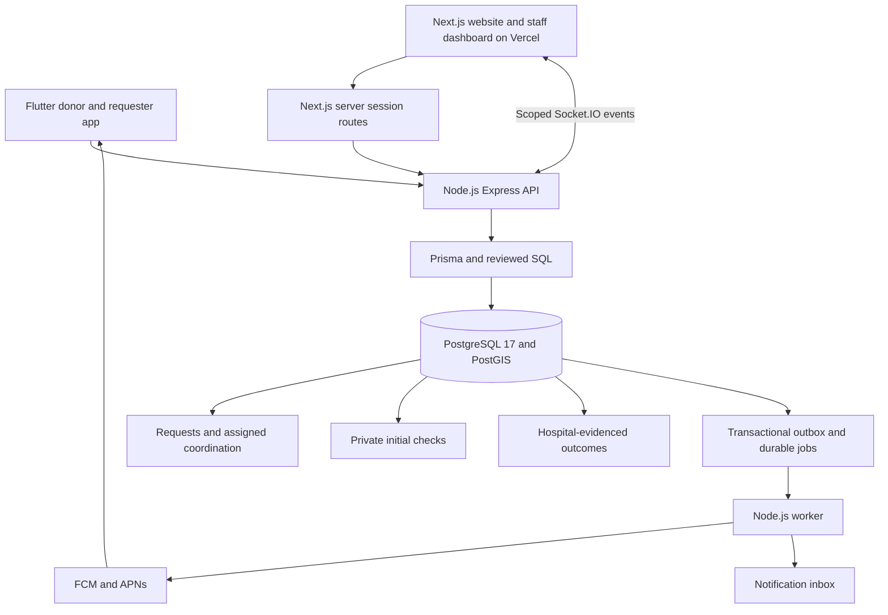

# NSS Blood Donor — Project Plan

## Document status

This is the product and delivery plan from foundation through a supervised pilot
and later expansion. It describes the target system, not a claim that features
are complete. Track partial work, implementation evidence and open gates in
[progress.md](progress.md). The ordered, dependency-aware execution tracker
is [featurelist.json](featurelist.json); features tagged `parallel` may proceed
alongside other ready work once their own prerequisites are complete.

The checkboxes in the success criteria, delivery stages, and required tests are
manual completion markers. Tick one only after its evidence is recorded in
[progress.md](progress.md). Feature dependencies and acceptance status remain
authoritative in [featurelist.json](featurelist.json); an unchecked stage item
does not block an independently ready feature.

## 1. Project charter

### Goal

Build a trustworthy donor-request coordination platform for Tamil Nadu, starting
with a small NSS and hospital pilot. A requester submits a need for staff review,
or assigned staff publish an organizational need at a verified hospital; consenting donors pledge; a handler performs
a basic initial check; the hospital assesses the donor on site; and a completed
donation is recorded only with hospital evidence.

The system coordinates people and status. It does not hold blood inventory,
diagnose illness, declare clinical eligibility, or replace hospital emergency
services. The hospital makes the final decision whether donation can proceed.

### Success criteria

- [ ] Every published request has a verified hospital and a reachable coordinating
  owner during published staffed hours.
- [ ] Donors and requesters can see accurate, privacy-safe progress and next steps.
- [ ] Only assigned staff can act on pledges; only hospital-evidenced completed
  donations produce history or certificates.
- [ ] The pilot can measure acknowledgement time, verified outcomes, no-shows,
  notification failures, accessibility, and user support quality.
- [ ] Operators can rebuild, monitor, back up, restore, and safely stop the service.

### Decisions agreed with the project owner

| Area | Decision |
|---|---|
| Platforms | Android/iOS app, responsive public website, hospital/NSS management dashboard. |
| Region | Tamil Nadu; Tamil and English throughout the core experience. |
| Publication | Either authorized hospital staff or NSS coordinator may create and publish requests for assigned hospitals; no mandatory second publisher. Requester submissions may also be reviewed/published by either role. |
| Urgency | NORMAL and URGENT use progressive zones; CRITICAL and EMERGENCY immediately use all enabled coverage. |
| Donor contact | Private required E.164 number for activation; self-reported until coordinator call validation. Phone OTP is later scope. |
| Handler check | Editable Tamil/English checkbox questionnaire; send answers and consenting donor details to assigned admin for a validation call; record answers privately with checklist version and coordination outcome. |
| Alerts and waiting | Normal 10/25/50 km then all configured coverage; emergencies immediately all coverage; atomic donor slots and fresh waiting-replacement offers. |
| Donation proof | Compressed private R2 acknowledgement upload or hospital reference/attestation; staff verification is required. |
| Hospital outcome | Hospital staff decide after on-site assessment; either assigned partner role records the outcome with hospital proof. |
| Authentication | Google sign-in and verified email/password initially; staff TOTP MFA. |
| Notifications | Real Firebase Cloud Messaging from the pilot. |
| Coverage | Publish each partner's staffed hours and direct hospital contact route outside them. |
| Clinical data | Store only the approved preliminary checkbox responses privately for coordination; no weight, diagnosis, hospital test values or detailed medical history. Hospital clinical screening remains separate. |
| Inventory | Blood-stock tracking and availability claims are outside scope. |
| SMS | Phone OTP and SMS later, when funded. |
| Development | Docker Compose PostgreSQL 17/PostGIS, Node.js/Express/Prisma backend, Next.js web and Flutter mobile. |
| Spending | Free allowances for a supervised pilot, with limits and upgrade triggers. |

### Pilot boundaries

Launch by invitation with approximately five hospitals, five NSS units and up to
1,000 registered users, subject to measured capacity and partner readiness.
Hospital clinical screening, testing, collection and patient care remain within
hospital systems. Camp management, inventory, component matching, and external
hospital integrations are future work only after the coordination pilot works.

## 2. Selected stack and Docker development

### Alignment with the Xerox Booking App

On 2026-10-01, the owner requested Flutter and reuse of the common layers in
`V:\xerox-booking-app\docs\PROJECT_TECHNICAL_GUIDE.md`. This section records the
adopted decisions so this project does not depend on access to that other checkout.
Use the same mobile, web, backend, database toolkit, push and live-dashboard
patterns. Printing, payments and pricing are outside this project's scope. Reuse the guide's
private presigned-upload pattern for compressed donation acknowledgement proof.
R2 also holds encrypted backups and generated artifacts; hospital medical records
and test reports remain excluded. Retain PostGIS, two-stage checking,
hospital evidence, Tamil/English, staff MFA and scoped access.

### Selected stack

| Layer | Selection | Reason |
|---|---|---|
| Mobile | Flutter/Dart, Riverpod | Same feature-based app and state-management pattern as the guide. |
| Mobile network/navigation | Dio, GoRouter, secure storage | HTTP refresh handling, authenticated deep links and Keychain/Keystore tokens. |
| Website/dashboard | Next.js App Router, React, TypeScript; Tailwind CSS/shadcn/ui retained | Public/user web and scoped hospital/NSS dashboard. |
| Web data/state | TanStack Query, Zustand, Axios; Recharts for reports | Same server-state, local-state, API and chart layers as the guide. |
| Web hosting/session | Vercel; Next.js server session routes | Secure HTTP-only cookies, CSRF/origin checks and server-held backend tokens. |
| API | Node.js, Express, TypeScript, Zod | Router/schema/service separation as in the guide. |
| API/worker hosting | Railway or Render | Persistent Express/Socket.IO service and separate durable worker. |
| Database | PostgreSQL 17 + PostGIS; Docker locally, managed PostgreSQL (for example Neon) in production | Transactions, spatial indexes and access controls; verify provider extension support. |
| Authentication | Express-owned identity, bcrypt password hashes, short-lived JWT access and hashed rotating refresh sessions | Verified email, Google/Apple identity linking, recovery and staff TOTP MFA. |
| Database access | Prisma Client with PostgreSQL adapter; Prisma migrations plus reviewed SQL | Typed ordinary queries; SQL for spatial operations and database workflow/security rules. |
| Background jobs | PostgreSQL transactional outbox/job tables and separate Node.js worker | Durable leased jobs, retry and scheduled zone evaluation without provider cron dependence. |
| Push | Firebase FCM with iOS APNs integration | Real mobile delivery; web push where supported. |
| Live staff updates | Socket.IO backend and web client | Authenticated, assignment-scoped updates; REST refetch after reconnect. |
| Forms/contracts | Zod and React Hook Form on web/backend; Dart models and Flutter form validation | One OpenAPI contract, TypeScript and Dart clients; server remains authoritative. |
| Localization | Flutter localization/ARB; i18next on web/backend | Same Tamil/English keys and reviewed copy, with parity checks across formats. |
| Monitoring | Structured logs, Sentry, web performance metrics | Redacted diagnostics and release visibility. |
| Storage | Private Cloudflare R2 | Compressed donation acknowledgement proof, encrypted backups and authorized generated artifacts; no medical-record uploads. |
| Tests | Vitest, React Testing Library, SQL/pgTAP, Playwright, Flutter unit/widget/integration tests, Maestro, k6 | API/database, browser and real-device coverage. |
| Tooling | pnpm for Node/web, Flutter/Dart SDK and pub for mobile, GitHub Actions | Pinned runtimes, lockfiles and separate language checks. |

Keep business data in ordinary PostgreSQL, version migrations, and isolate
provider adapters. Supabase is not part of the selected stack: no Supabase hosting, Auth, Edge
Functions, client database API or Cron. Choose managed PostgreSQL with verified
PostGIS support; existing Supabase files are migration references only.
Flutter uses Firebase Messaging with native Android/iOS configuration and APNs
for iOS. Real-device notification testing remains a release gate.

### Architecture

Next.js server session routes own browser cookie transport; Express/database
own authentication, authorization and business transitions. Next.js runs with
its server runtime on Vercel, including authenticated routes; a static export
is no longer the application hosting contract. Mobile calls Express via Dio.
Socket events never authorize a mutation and must recheck active membership,
assignment and session status; reconnect refetches authoritative REST state.

Target folders follow the guide: `mobile/` for Flutter; `admin/` for the Next.js
public/user/staff surfaces; `backend/src/modules/` for routers, Zod schemas and
services; `backend/prisma/` for models, migrations and synthetic seeds; shared
OpenAPI/localization assets in `packages/`. Share contracts and content across
Dart/TypeScript rather than assuming shared executable client code.

### Implementation entry and foundation ownership

Start with F002; it is the only ready unfinished feature. Its completion requires
an isolated reviewed baseline, pinned pnpm 10.32.1/Node 24 and Flutter SDK/pub,
working Compose PostgreSQL 17/PostGIS, correct environment/workspace configuration,
real command wrappers and demonstrated clean-checkout startup/checks. Reconcile
old Supabase/Hono/apps/* configuration there; do not execute it as the active stack.
F002 owns minimal runnable scaffolds/health checks, not donor domain completion.

F003 owns backend identity/session, organizations/memberships and database/runtime
foundation; F004 owns donor preferences, requests, policies, slots/pledges, checks,
outcomes/evidence and their tested constraints/transition contract. Features that
consume those records require F004 directly or transitively. F006 proves backend
identity APIs; F008 owns browser session transport and F009 owns mobile/client
credential handling, so authentication acceptance has no circular client dependency.
Contract/data features test seeded transitions without claiming later UI/worker
implementation; full journeys are accepted under their respective feature IDs.

Baseline capture must stage explicit feature-owned paths, review staged diff for
secrets and unrelated legacy deletions, commit/push to the configured project remote,
and verify the scaffold in a clean checkout. Do not use blanket staging in this
mixed working tree. Baseline/remote problems are recorded as F002 blockers.

### Docker workflow and stack transition

The target local stack uses Docker Compose for PostgreSQL 17 with PostGIS,
and an optional local email catcher. Express, its worker and Next.js run as
local Node processes; Flutter uses the pinned SDK and a simulator/device.
Prisma migrations enable extensions and include reviewed spatial, constraint,
workflow and permission SQL where necessary.

Existing `supabase/` files and SQL are unapplied drafts from the previous stack.
Port their domain constraints and scoped workflows into Prisma migrations;
replace Supabase Auth identities/roles and queue integration before acceptance.
Do not run both migration systems or claim the old scripts implement this stack.
`F002` owns workspace/command alignment; `F003` owns the reviewed migration port.

Requirements:

- Docker Desktop with the WSL2/Linux engine running.
- PostgreSQL 17 locally and the same major in hosted environments; PostGIS enabled.
- Pinned Flutter/Dart SDK, `pubspec.lock`, Node dependencies and `pnpm-lock.yaml`.
- Persistent development volumes; isolated disposable test databases.
- Local services bound to localhost by default.
- Synthetic hospitals, NSS units, users and workflow states in seeds.
- Separate development/production Firebase projects and credentials.
- Startup validation with clear missing-secret errors.
- No production credentials or patient data in fixtures.

| Command | Required behavior |
|---|---|
| `pnpm backend:up` | Start Compose containers and wait for healthy database services. |
| `pnpm backend:dev` | Run Express and the durable Node worker with local changes. |
| `pnpm backend:down` | Stop while preserving development data. |
| `pnpm db:reset:local` | Rebuild local Prisma migrations/seeds only; reject remote targets. |
| `pnpm db:types` | Generate Prisma Client and TypeScript/Dart OpenAPI models; detect drift. |
| `pnpm test:backend` | API/permission/integration tests against isolated PostgreSQL. |
| `pnpm dev:web` | Next.js public/user/staff web with server session routes. |
| `pnpm dev:mobile` | Wrapper for Flutter run with a development API URL. |
| `flutter analyze`, `flutter test` (in `mobile/`) | Dart analysis and unit/widget checks; device integration tests separately. |

CI must reconstruct the database and run Node/web and Flutter checks from a
clean checkout. See [progress.md](progress.md) for which commands/services are
implemented. Current command declarations have not been migrated or validated.

## 3. Product, data, and API specification

**Owner clarification — 2026-10-02:** Preserve the nine-step donor flow. Either
authorized hospital staff or NSS coordinator publishes; donor checkbox responses
reach the assigned admin before the dialler-based validation call. This supersedes
the earlier no-response-storage and second-reviewer planning restrictions.

### Roles and permissions

A user may hold several memberships. Ordinary accounts have donor/requester
capabilities; verified memberships grant elevated privileges.

| Role | Permissions |
|---|---|
| Visitor | Public information, help, privacy and verified hospitals. |
| User/donor | Own profile, submissions, approved requests, own pledges/history. |
| NSS controller | Review/publish for assigned partner hospitals; coordinate pledges, perform the basic check, and record hospital-evidenced outcomes. |
| Hospital staff/coordinator | Review/publish for own hospital; coordinate pledges, perform the basic check, and record hospital-evidenced outcomes. Hospital clinical staff decide whether donation may proceed. |
| Platform administrator | Verify organizations, manage memberships, investigate abuse and administer platform. |

- Either authorized staff role may publish; two approvals are not required.
- Every staff action is restricted to explicit assignments.
- Either authorized hospital staff or NSS coordinator can publish any ready request
  in assignment, including one they created. A separate publisher is not required.
  Staff cannot verify their own donation; scope, MFA, evidence and audit still apply.
- Hospital safety holds stop matching; NSS cannot override them.
- Role revocation takes effect through database checks immediately.
- Never expose unrestricted donor contact lists.

### Launch journeys

**Donor:** sign in; choose Tamil/English; complete adult profile and consent;
choose locality manually or grant foreground location; browse by distance/group/
urgency/hospital; read details and pledge; complete a checkbox questionnaire and admin validation call
with the assigned handler; travel only after a proceed decision; attend hospital
assessment; receive a private outcome, verified history, and an optional
certificate only after a completed donation. The donor may cancel at any time
before completion and may pause future alerts.

**Requester:** choose the actual verified hospital; enter group, quantity, urgency,
deadline and private hospital reference; submit; see acknowledgement, review,
publication, coordination and closure milestones. The timeline contains no donor
identity, basic-check decision or hospital assessment information.

**Handler:** an assigned NSS controller or hospital coordinator reviews only
consenting pledges, follows the hospital-approved basic checklist, and records
`PROCEED_TO_HOSPITAL`, `DO_NOT_PROCEED`, or `HOSPITAL_ADVICE_NEEDED`. The app stores
approved questionnaire responses privately, plus outcome, reviewer, time and
checklist version; no measurements or detailed clinical records.
`PROCEED_TO_HOSPITAL` authorizes coordination of travel, not clinical eligibility.
An uncertain case needs hospital direction before travel.

**Hospital and coordination staff:** the hospital performs its own confidential
assessment and tests and decides whether donation can proceed. Either assigned
partner role may record `DONATED`, `DEFERRED`, or `DID_NOT_DONATE` with a hospital
receipt/reference or named staff attestation. Staff see scoped review and pledge
queues, record contact and handoffs, close requests, manage disputes and export
only data within their assignment.

**Account/support:** registration, verification, reset, logout, session revocation,
preferences, language, data export, deletion request and abuse reports. Provide real
empty/loading/offline/permission-denied/expired-session/error states. Every action
has an accessible success or error response.

### Donor registration and activation

Donor registration is a pilot requirement on both web and mobile, delivered by
authentication (`F006`), donor onboarding (`F016`) and the clients (`F026`, `F028`).
Create or resume one profile for the authenticated account after verified
email/password registration or supported provider sign-in. Complete the adult
participation confirmation, name, self-reported blood group, Tamil/English
preference, coarse locality, private callable phone number, availability and
purpose-specific consent for donor alerts and staff contact sharing. Questionnaire consent is obtained when accepting
a request; registration does not collect health answers or test results.

Use manual locality selection when foreground location is denied or unavailable.
Store only coarse locality and its confirmation time, not movement history.
Incomplete registration, unverified identity, stale locality/preferences, paused
availability or missing required matching/contact consent excludes the account
from automated donor matching. A missing/invalid phone number also blocks donor
activation and pledging; incomplete profiles can still sign in and be resumed.
Donors can complete onboarding with push denied
and use the inbox; OS push permission is separate from alert consent. Repeated
submission must not create duplicate profiles or consent events. Registration
does not grant staff privileges or declare clinical eligibility.

Allow donors to edit preferences, pause alerts, withdraw consent and resume
unfinished onboarding. Show completion and errors in Tamil and English and
enforce the activation rules on the server before matching or pledging.

### Donor contact and verification contract

- Store a private E.164 number (maximum 15 digits after the plus sign); default
  country picker India/+91 and normalize with a phone-number parsing library.
  Reject invalid formatting. Numbers may be shared by family members and are not
  unique identifiers or login credentials. Email/provider verification remains
  the account-verification gate; phone OTP remains F043.
- A valid self-reported number and contact-sharing consent permit activation and
  pledging. Do not claim the number is verified until the assigned coordinator
  successfully calls, confirms the donor and records contact validation against
  that contact version. Failed/unanswered calls never confirm readiness.
- A proceed decision and successful call validation are both required before
  CONFIRMED. Before travel, changing the number invalidates the old validation
  and returns a confirmed pledge to pending checking with a fresh contact deadline.
  After EN_ROUTE/ARRIVED, keep attendance state, invalidate contact validation and
  notify assigned staff to reconcile; do not silently release a travelling slot.
- Reveal the current number only to the donor and assigned coordinating staff
  while sharing consent is active. No public/requester access, bulk contact export
  or automatic recording. Historical audit retains version/result, not copied
  phone numbers. Withdrawal removes contact access immediately.

### Main product surfaces

| Surface | Essential screens |
|---|---|
| Public website | Purpose, how coordination works, verified hospital directory, privacy, help and partner staffed hours. |
| Donor/requester app and web | Registration/sign-in, onboarding/profile/consent, request search/detail/submission and safe wider-search milestones, pledge and basic-check status, directions, private outcome, notifications, verified history and account controls. |
| Staff dashboard | Scoped request and pledge queues, acknowledgement/assignment, current alert zone and search status, initial-check action, hospital-outcome recording, evidence review, audit trail, reports and partner administration. |

Every surface uses the same server workflow and Tamil/English content. Public or
requester views expose only coordination status, never a donor's check result.

### Agreed end-to-end coordination flow — 2026-10-02

1. Registered, activated donors already have group, locality, availability and
   consent. Authorized hospital/NSS staff publish a verified-hospital request
   with quantity, urgency, deadline, named coordinator and approved policy.
2. Normal requests search 10 → 25 → 50 km, then all matching donors throughout
   the configured service coverage. Critical/emergency requests immediately use
   all coverage. Consent, availability and group matching apply in every stage.
3. Foreground notifications open an accept/reject dialog; background notifications
   open the request after a tap. Reject skips this request. Accept opens the five
   checkbox questions; submitting the versioned responses and sharing consent
   atomically creates an idempotent reserved/waiting pledge. Answers and consenting
   donor details become visible to the assigned admin for validation.
4. The scoped dashboard receives consenting donor contact/pledge details. An
   assigned coordinator uses click-to-call in the device dialler, privately
   reviews the submitted answers, calls to validate readiness and records the
   contact result and coordination outcome. Answers remain private to that donor
   and assigned hospital/NSS staff, never the requester or other donors. This
   pilot does not implement automatic call routing or recording.
5. Server transactions reserve the required donor slots and place additional
   acceptances on a waiting list. Reserved donors are not yet cleared to travel;
   only validated and confirmed donors receive travel instructions.
6. Once required donors are validated, confirmed and ready, the admin sends the
   requesting person a donors-ready notice to pause unnecessary additional donor
   searching. The message clearly says donation is pending. Pause invitations;
   a later shortfall sends a fresh update and restarts replacement coordination.
7. After arrival and donation, the donor uploads the compressed hospital donation
   certificate/acknowledgement through private R2 storage. Assigned staff verify the hospital evidence; a receipt
   reference or named hospital staff attestation is an alternative to uploading.
8. The hospital/NSS admin reviews the uploaded certificate and validates the
   hospital-evidenced donation. When required verified units are met, that
   validation transaction closes the request, resolves remaining commitments,
   notify affected donors/requester and update the dashboard/history.
9. Withdrawal, failed contact, no-show or hospital non-donation releases a slot,
   alerts the coordinator and invites a waiting replacement to reconfirm. The
   requester sees the shortfall without another donor's private reason.

### Nine-step flow coverage and feature ownership

| Owner's step | Required implementation | Feature owners |
|---|---|---|
| 1 | Either hospital staff or NSS coordinator publishes assigned request. | F011/F012/F013 |
| 2 | Available/local donors receive FCM; shortfalls expand to all coverage; critical/emergency immediately all zones. | F016/F017/F023/F024 |
| 3 | Accept/reject popup; Accept opens editable checkbox questions and submits private answers to admin. | F018/F019/F026/F028 |
| 4 | Admin receives details/answers and opens phone dialler for validation call. | F019/F027 |
| 5 | Reserve required donors; surplus acceptances wait and receive waiting notice. | F018/F023/F026/F028 |
| 6 | Admin sends requesting person a donors-ready notice to pause extra search. | F015/F019/F023/F027 |
| 7 | Arrive/donate then upload compressed hospital certificate privately to R2 using Xerox upload flow. | F020/F021/F022/F026/F028 |
| 8 | Hospital/NSS admin validates donation; verified required units close request and notify/update dashboards. | F012/F021/F022/F023/F027 |
| 9 | Failed visit/donation records neutral failure reason and alerts admin; waiting replacement is invited to reconfirm. | F018/F020/F021/F023/F027 |

### Request state machine and publication authority

Request status is `DRAFT`, `SUBMITTED`, `CHANGES_REQUESTED`, `REJECTED`, `OPEN`,
`FULFILLED`, `CANCELLED` or `EXPIRED`. A hospital safety hold is an independent
flag, not a terminal request state. Default publication lifetime is 24 hours;
effective expiry is the earlier of the request deadline and published expiry.
Authorized renewal is allowed only while OPEN and before effective expiry.

Each request stores `origin: REQUESTER | STAFF`, creator, coordinating hospital,
requester/contact reference where applicable and version. Staff-originated needs
must name a reachable requesting contact privately; creator, coordinating owner
and requesting contact are distinct fields. Staff creation requires assignment/MFA.

| Action | Starting state / actor | Result and required effects |
|---|---|---|
| Draft/correct | Owner; DRAFT or CHANGES_REQUESTED | Save draft; only owner edits unpublished details. |
| Submit | Requester owner; DRAFT or CHANGES_REQUESTED | SUBMITTED; assign review queue/owner and acknowledgement deadline. |
| Return/reject | Either assigned staff/coordinator; SUBMITTED | CHANGES_REQUESTED or REJECTED; required reason and owner notice. |
| Publish submission | Either assigned staff/coordinator; SUBMITTED | OPEN; require verified/non-held hospital, future deadline, coordinator/backup and approved policy; atomically audit and queue initial search. |
| Direct staff publication | Either assigned hospital staff/NSS coordinator; STAFF-origin DRAFT | OPEN with the same publication gates and audit; no separate publisher required. |
| Edit published need | Assigned staff; OPEN | Audit quantity/deadline/urgency edits and reconcile slots/alerts; group/hospital changes require cancellation and a new request. |
| Renew | Assigned staff; unexpired OPEN | Extend published expiry within approved limits and future deadline; never revive expired requests through renewal. |
| Fulfill | Assigned staff donation-validation transaction; OPEN | Atomically set FULFILLED when verified units meet requested units; resolve coordination, notify donor/requesting contact and update dashboard. Explicit staff reconciliation uses the same guard. |
| Cancel | Owner or assigned staff; DRAFT, SUBMITTED, CHANGES_REQUESTED or OPEN | CANCELLED with reason; stop new coordination, release pending/waiting slots and notify staff/donors. |
| Expire | Trusted worker or guarded read/write; OPEN past effective expiry | EXPIRED; stop new coordination and release pending/waiting slots; attendance/evidence requires reconciliation. |
| Hold/release | Assigned hospital staff; verified hospital | Hold blocks publication, acceptance, offers and new travel instructions; preserve pledge/attendance state and notify staff/donors. Only hospital staff release with reason; NSS cannot override. |
| Correct/reopen | Assigned staff; FULFILLED after evidenced correction produces shortfall | Audit correction and reopen as OPEN only with fresh future deadline, valid policy and reconciliation; queued old actions remain invalid. CANCELLED/EXPIRED/REJECTED need a replacement request. |

Closure ends coordination commitments with recorded operational reasons; it does
not erase arrival or donation evidence. On hold, retain reservations/commitments
and suspend invitation, contact and offer deadlines for pending donors; request
expiry still runs. Authorized release reevaluates consent/availability and issues
fresh bounded deadlines/offers before restarting. Already travelling/arrived donors
require direct hospital coordination rather than automatic state reset/promotion.
Hospital outcome reconciliation for visits that already occurred remains allowed
on held/closed requests with attendance date, evidence and audit; never authorize
new travel from that exception. Every transition uses expected version/idempotency,
server expiry checks and atomic state/audit/outbox writes. Test invalid and concurrent
transitions against this table before feature acceptance.

### Canonical urgency and partner policy

Use one enum across PostgreSQL, Zod/OpenAPI, TypeScript and Dart:
`NORMAL`, `URGENT`, `CRITICAL`, `EMERGENCY`. NORMAL/URGENT follow progressive
10/25/50 km then all coverage; CRITICAL/EMERGENCY immediately broadcast across
coverage. Both immediate levels have the same reach in v1; distinct labels reflect
hospital-entered priority, not an app clinical assessment. Upgrading to either
immediate level queues only uninvited donors. Downgrading never recalls sent
notifications or resets rejection/deduplication history.

F003/F004 must not copy the old LOW/MEDIUM/HIGH constraint. Because draft SQL has
not been applied, use canonical values for new schemas/seeds. If importing legacy
requests later, map LOW→NORMAL, MEDIUM→URGENT, HIGH→CRITICAL with audit; require
explicit hospital classification for EMERGENCY rather than infer it.

Partner policy requires coverage, per-urgency response/contact/offer durations,
locality/preference freshness limits, contact pauses/rate limits, renewal limits
and the v1 donor-slot rule. Response/contact/offer durations are integer seconds
from 1 through 86400, with effective job deadlines capped by request expiry.
Freshness limits are integer seconds from 1 through 7776000 (90 days); operational
contact pauses are 0 through 7776000 seconds, independent of hospital clinical
screening. Contact limits are positive integers, at most 100 invitations per donor
per rolling 24 hours; partners choose lower operating values. Renewal cannot exceed
the request deadline. CRITICAL/EMERGENCY skip radial response waiting regardless
of the configured response field.
No implicit production timers or coverage: missing/unapproved policy blocks
publication. Synthetic local fixtures supply clearly labelled test values only;
partner-approved values are deployment configuration, not implementation choices.

### Pledge and two-stage checking

`reserved PLEDGED -> call + initial check -> CONFIRMED -> EN_ROUTE -> ARRIVED -> hospital outcome`

`WAITLISTED -> REPLACEMENT_OFFERED -> fresh acceptance -> reserved PLEDGED`

- Initial check outcomes: `PROCEED_TO_HOSPITAL`, `DO_NOT_PROCEED`, or
  `HOSPITAL_ADVICE_NEEDED`. A proceed outcome moves the pledge to `CONFIRMED`
  only with valid contact validation and a live reserved slot. Do-not-proceed ends
  it as `DECLINED`; uncertain cases wait for hospital advice within the bounded
  contact deadline. Deadline expiry releases the pending slot without recording
  a hospital clinical outcome.
- Only a confirmed pledge may advance to travel. A documented hospital direction
  can resolve an uncertain initial check. Offline coordination that skipped an
  app step needs a reason and hospital evidence before final recording.
- Hospital outcomes: `DONATED`, `DEFERRED`, or `DID_NOT_DONATE`. Only `DONATED`
  creates verified donation history and a certificate. A deferred donor receives
  a private neutral message directing them to the hospital for advice.
- Donors create/cancel own pledges and record travel/arrival. Staff record checks,
  no-shows and hospital-evidenced outcomes. Neither role may verify their own
  donation; a donor cannot mark themselves donated.
- At most one active pledge per donor in the pilot. Request closure resolves
  active pledges and stops new actionable alerts. A pledge, initial check, or
  hospital arrival never counts as a completed donation.

### Slots, waiting list and replacement coordination

- Keep requested units, donor-slot target, reserved slots, confirmed donors and
  hospital-verified units separate. In v1 the slot target equals outstanding whole-
  blood units (`max(0, requested - verified)`); surplus donors wait rather than
  adding travel slots. Hospital-approved policy adopts this rule; do not model component yield
  or promise one acceptance equals one donated unit.
- Accept atomically into `PLEDGED` with a reserved slot or `WAITLISTED` when full.
  Reserved slots have a partner-approved contact deadline and never authorize
  travel. Waiting/uncertain donors do not count as confirmed coverage.
- Waiting order is acceptance time then pledge ID. A waiting commitment counts
  toward the one-active-pledge rule. Donors may withdraw to accept another request.
  Show waiting status, explain not to travel and allow withdrawal; do not expose
  other donors or promise a donation opportunity.
- Promote one donor per vacant slot into `REPLACEMENT_OFFERED`, reserving that
  slot until the partner-approved offer deadline. Require fresh acceptance and
  coordinator validation; reject, expiry or failed contact advances to the next
  waiting donor. Promotion/expiry/contact deadlines use durable jobs and locks.
- Release on cancellation, no-show, contact timeout, do-not-proceed, deferral or
  non-donation. Verified donation ends that commitment, releases its reservation
  and reduces outstanding unit/slot need in the same transaction before promoting
  anyone; it must not create a replacement for an already fulfilled unit.
  Recheck request status, consent, availability and active commitment
  before promotion. Repeated/concurrent workers cannot overbook or promote twice.
  Coordination timeout/rejection is a neutral DECLINED/CANCELLED outcome, distinct
  from hospital DEFERRED/DID_NOT_DONATE. A rejected/expired replacement ends that
  waiting commitment; renewed voluntary acceptance joins the queue at its new time.
- Use occupied slots to bound reservations and confirmed donors to measure search
  coverage; a full pending queue pauses invitations only until its contact deadline.
  Reevaluate on every loss. Process waiting replacements before wider invitations.
- Declined invitations remain declined across urgency changes and wider search;
  a donor may explicitly reopen the request and volunteer while it is still open.
- Quantity/deadline/urgency edits are versioned and audited. Quantity reductions
  release surplus non-travelling slots in reverse reservation order; staff contact
  travelling/arrived donors and reconcile them before reducing below committed
  capacity. External fulfillment/cancellation stops travel and resolves the queue.
- A claimed completed donation with evidence pending requires hospital
  reconciliation; missing/failed upload alone must not dispatch a replacement.
  Show verified partial units and pending verification separately. Corrections
  reevaluate shortfalls; reopening a fulfilled request requires an audited staff
  decision with fresh deadline/policy, not an automatic stale-alert restart.

### Donor checkbox questionnaire and admin validation call

After Accept, show five hospital-reviewed draft questions with mutually exclusive
Yes / No / Unsure checkbox choices and no preselected response:

1. Are you feeling unwell today or aware of a serious health concern that the
   blood-centre clinician should discuss with you?
2. Have you taken any medicine in the past 24 hours, or are you receiving ongoing
   medication/treatment?
3. Have you consumed alcohol within the last 24 hours?
4. Have you donated blood recently or been told by a blood centre to wait?
5. Have you recently had surgery, significant dental treatment, tattoo/piercing,
   or another event to discuss with the blood-centre clinician?

These preliminary questions support the admin call, not automatic eligibility.
Never advise stopping prescribed medication or treat 'no medicines for 24 hours'
as a universal rule. Hospital clinicians perform full screening and decide whether
donation can proceed. See the [government donor FAQ](https://eraktkosh.mohfw.gov.in/BLDAHIMS/bloodbank/eraktkoshfaq.cnt).

- Authorized hospital/NSS administrators can create, modify and activate question
  versions for assigned hospitals under the hospital-approved screening policy;
  each change records author/time/version. Question content needs hospital review
  before real use, but the admin edit/create functionality is included in v1.
  Each request pins its questionnaire version at publication; new edits apply to
  future requests and never alter submitted questions or responses.
- Require an explicit response to every active question and consent to share these
  answers with assigned staff. Persist only question IDs, immutable version and
  bounded Yes/No/Unsure responses, donor/pledge identity, consent and submission
  time in a private protected record. Do not ask for diagnosis, measurements,
  laboratory values or free-text medical histories. Donors see their own record.
- Questionnaire submission and acceptance are idempotent and transactional;
  interrupted forms can retry without duplicate pledges/answers. No silent default
  'No' for unchecked choices. Waitlisted donors receive waiting status and do not
  travel; staff can review their submitted questionnaire too.
- The admin panel receives donor contact and submitted checkbox responses, then
  the assigned hospital/NSS coordinator calls the donor for validation. The call
  records contact result, decision, reviewer/time and questionnaire version.
  Successful validation plus a proceed decision and reserved slot confirm travel.
  Uncertain answers require hospital direction; no checkbox automatically approves
  or rejects donation. A replacement donor freshly reconfirms answers before calling.
- Restrict responses to donor/assigned staff with MFA for privileged access; encrypt
  in transit/at rest, audit access and apply a field-level approved retention period
  before enrollment. Withdrawal immediately removes future sharing access and
  follows the documented commitment/replacement rules; deletion follows the
  approved evidence/audit schedule. Never include answers in FCM, Socket.IO broad
  events, requester views, exports for other users, logs, analytics or crash reports.

### Urgent-request operating procedure

- The app is a coordination channel; it must display the partner hospital's
  direct contact route and tell users to contact the hospital directly for
  immediate clinical help. Submission or push acceptance is not a guarantee of
  review, a donor, compatible blood, or treatment.
- Every submitted request enters a staffed queue with an assigned hospital or
  NSS owner, a visible submission time, and an acknowledgement state. Agree on
  staffed hours and acknowledgement/escalation time limits with pilot partners
  before inviting users; publish the support route in Tamil and English.
- Escalate unacknowledged urgent requests and requests nearing deadline to a
  named backup contact. If nobody accepts coordination or no donor responds,
  inform the requester and use the partner's manual phone workflow. Record each
  handoff and closure reason; test the path with push and backend outages.

### Donation evidence

Require a hospital receipt/reference or named hospital staff attestation for
every recorded final outcome. For `DONATED`, record date, confirmed quantity,
recorder identity/organization and verification source. Keep the hospital's
clinical assessment, test values, diagnosis and detailed questionnaire outside
the app. Corrections append audit events; disputed or revoked donations
invalidate certificates.

### Private donation-proof upload

Reuse the Xerox guide's flow: authenticated presign request → direct private R2
upload → backend completion/verification → scoped hospital/NSS evidence review.
PostgreSQL stores object metadata/key; an uploaded file alone creates no donation.
Default to one JPEG/PNG/PDF acknowledgement per pledge, maximum 2 MiB after
compression. Preview readable text before upload; reject unreadable evidence and
allow a hospital reference/attestation instead. Client compression never bypasses
server limits or content verification. Do not accept medical reports.

- Authorize ownership/request scope before presign and completion. Use unique
  server-generated keys and five-minute upload grants; finalize verifies actual
  size/type/content, strips image metadata, scans/quarantines suspicious content
  and binds proof to the correct donor/pledge. A checksum flags reused proof for
  review without automatically rejecting legitimate shared hospital receipts.
- Serve through authenticated scoped access or short-lived download grants;
  no public bucket or permanent object URL. Retried finalization is idempotent.
  Rejected/unfinished uploads cannot enter verified evidence or requester views.
- Clean unfinalized objects after 24 hours and apply the partner-approved
  evidence-retention/deletion schedule to finalized files. Never log signed URLs.
  Backups/restoration cover evidence metadata and required retained objects.
- Donor upload may remain verification-pending while hospital staff provide a
  reference/attestation. Staff reconcile delayed uploads, disputed proof and
  outcome corrections; uploaded hospital certificates are donation evidence,
  while any app-generated verification certificate derives from verified donation.
- Staff operational failure reasons use bounded neutral codes such as withdrawn,
  unreachable, no-show or hospital unable-to-proceed; no diagnosis/free-text health
  reason is collected. Replacement notices never disclose the prior donor's reason.
- Verified donation dates support hospital-approved contact pauses and reminders;
  donors can report recent outside-app donation privately and pause availability.
  The app must not treat registered status or elapsed time as clinical clearance.

### Matching and clinical boundaries

- Indexed PostGIS discovery queries; 25 km default, options 10/25/50 km.
  Proactive donor alerts use the progressive zones below, independently of a
  donor's current discovery filter.
- Notifications match requested group, availability, consent, locality and contact restrictions.
- One canonical blood-group enum, displayed as O−, AB+, etc.
- Manual locality fallback; coarse stored locality; no background movement tracking.
- Stop using stale locality/preferences until reconfirmed.
- Nearby hospitals are suggestions; requesters select the actual verified institution.
- The basic checklist is approved and versioned by each participating hospital.
  The handler may discuss reported weight and current health concerns but records
  the approved preliminary checkbox responses and coordination outcome privately;
  no weights/detailed clinical records. No app rule declares medical eligibility.
- Hospital clinical staff retain eligibility, compatibility, testing and
  collection decisions. A failed hospital assessment must not create a donation.

[Government donor-selection guidance](https://eraktkosh.mohfw.gov.in/BLDAHIMS/bloodbank/about.cnt?hmode=DOWNLOADDOCUMENTNHRM&type=20)

### Zone-based donor requests and automatic expansion

Geofencing means indexed server-side matching from the verified hospital to
consented coarse donor locality; no background movement tracking. Normal search
uses 10 km, additional donors over 10–25 km, additional donors over 25–50 km,
then previously uncontacted matching donors anywhere in configured coverage.
Critical/emergency publication skips the radial waiting stages and immediately
contacts all matching donors in that coverage. Upgrading an open request to
critical/emergency immediately queues only previously uninvited donors.

Coverage is the versioned set of enabled Tamil Nadu pilot localities/districts,
not all accounts nationwide. Wide alerts may reach beyond 50 km inside coverage;
show distance and deadline and have coordinators check achievable arrival times.
The previous 50 km automatic cap is superseded by this owner-approved workflow.

- Every stage enforces requested group, activated registration, availability,
  consent, fresh locality/preferences and contact limits; exclude commitments
  elsewhere. All-zone emergency alerts do not override these protections.
- Advance immediately if a stage has no contactable matching donors; otherwise
  use hospital-approved urgency response windows and outstanding confirmed-donor
  coverage. Reserved slots/offers pause new invitations only for bounded contact
  windows. Waiting donors never count as confirmed or donated units.
- Persist policy/coverage snapshots, stage, due evaluation, pause/exhaustion reason
  and audit. Worker retries and overlapping stages invite each donor/request once;
  replacement offers are separately deduplicated per offer, not suppressed by the
  original invitation key. Recheck state and consent before every queued send.
- Shortfalls trigger waiting-list promotion, then resume broader search if needed.
  Once coverage is exhausted, notify the assigned coordinator/backup and provide
  manual hospital phone handoff plus a neutral requester milestone.
- Closure, expiry, fulfillment and hospital safety holds stop new invitations and
  evaluations. Holds suspend replacement offers/travel instructions; staff must
  reconcile existing travellers. Resume only after an authorized audited release.
- Publication requires approved response/contact/offer deadlines, slot policy and
  coverage. Staff see stage, pending/confirmed/waiting counts and next evaluation;
  requesters see only safe coordination, shortfall and verified-fulfillment status.

### Data model

| Group | Records |
|---|---|
| Identity | Profiles, donor preferences, consent history, account status. |
| Organizations | Hospitals, NSS units, memberships, partnerships, verification history. |
| Coordination | Requests, ownership/acknowledgement, coverage/policy/search state, slots, waiting list/replacement offers, contact deadlines/attempts, versioned questionnaire text/private responses/sharing consent, initial-check and hospital-outcome events, private proof metadata and requester-safe timeline events. |
| Communication | Devices, inbox, delivery attempts, durable jobs. |
| Governance | Audit events, abuse reports, privacy requests, certificates. |
| Reliability | Idempotency, rate-limit counters, scheduled-job state. |

Use UUIDs/UTC; foreign keys; bounded quantities/enums; required references; unique
active-pledge/operation-key constraints; versions for concurrency; spatial/list
indexes. Separate contacts, private check outcomes and evidence from broadly
readable fields. Store only approved private preliminary checkbox responses; no weights,
illness names, test values, diagnoses or detailed medical histories. Verified donation dates stay separate from self-reports.

### API

Ordinary `POST /v1/requests` derives REQUESTER origin from the authenticated owner.
Scoped `POST /v1/requests/staff` creates a STAFF draft with a required private
requesting contact (E.164 number, or registered requester contact reference).
`POST /v1/requests/:id/publish` enforces assignment/MFA/publication gates for either staff role; caller-
provided origin/creator/role fields cannot bypass it. Existing requests returned
through APIs expose origin to their owner/assigned staff, not requesting contacts
or donor identities to public readers.

Versioned REST, OpenAPI documentation and generated client types:

- `/v1/me`: registration completion, activation status, profile, preferences, consent, sessions, export/deletion.
- `/v1/hospitals`: verified directory.
- `/v1/requests`: submission, discovery, details, review, publication, closure,
  scoped zone-search status and requester-safe expansion milestones.
- `/v1/requests/:id/notify-ready`: assigned admin sends the requesting person
  the ready-donor notice only while confirmed donors meet outstanding need.
- `/v1/requests/:id/questionnaire`: authenticated donor view of the pinned questions.
- `/v1/pledges/:id/questionnaire`: donor/assigned-staff private response access.
- `/v1/pledges`: accept/reject with versioned questionnaire/consent submission,
  waiting status, replacement offers/reconfirmation,
  contact attempts, initial-check decision, travel/arrival and permitted transitions.
- `/v1/pledges/:id/evidence/presign` and `/v1/pledges/:id/evidence/complete`:
  authorized private donation-proof upload and idempotent object validation.
- `/v1/hospital-outcomes`: hospital-evidenced donation/deferral/non-donation recording.
- `/v1/donations`: verified history, certificates and corrections.
- `/v1/devices`, `/v1/notifications`: device registration and inbox.
- `/v1/organizations`, `/v1/memberships`: scoped administration, hospital-approved
  checklist versions and coverage/response/slot policy management.
- `/v1/reports`: scoped reports and abuse reporting.
- `/health/live`, `/health/ready`: service/dependency health.

Validate bodies/queries/IDs/lengths/coordinates. Deterministic cursor pagination:
default 20, max 100. Require idempotency for pledges, publication and donation
confirmation. Return 409 for stale versions/concurrent invalid transitions.
Consistent errors contain code, message, optional fields and correlation ID;
exclude database internals, stacks and secrets. Workflow mutation, audit and
notification enqueue must commit together. Revoke direct client mutations that
would bypass workflows.
Reject unexpected clinical fields at the API boundary. Questionnaire writes accept
only approved question IDs/version, bounded responses and consent; initial-check
writes accept outcome/version and hospital direction when needed. Assigned staff
can read answers through private scoped endpoints; generic request/pledge lists
never embed them for public/requester consumers. Hospital-outcome writes accept only the outcome,
hospital proof, and donation facts when the outcome is `DONATED`.

### FCM delivery

- Register after authentication; rotate tokens; multiple devices; unregister on logout.
- Persist inbox before push; bounded batches, retry/backoff, failed-job visibility.
- Schedule durable zone evaluations; normal publication starts at 10 km,
  emergency publication starts across configured coverage, and later stages
  enqueue only newly matched recipients. Worker retries cannot repeat expansion
  events or donor/request alerts; the request state and donor rules still apply.
- Remove invalid tokens; recheck request state and consent before sending.
- Deduplicate event/recipient/device and each replacement offer; expiry bounded
  by request/offer useful lifetime. Fetch current server state on notification tap.
- Show accept/reject guidance in the foreground; background notifications open
  the request after a tap. No guaranteed forced popup or delivery is promised.
- Limit repeated alerts per donor and request; respect availability, opt-out and
  contact pauses. Do not send travel instructions before the initial check allows it.
- Keep sensitive data off lock screens; authenticated deep links and foreground handling.
- Deferral messages contain no medical reason; they direct the donor to the
  hospital for private advice. Requester alerts contain no donor check outcome.
- Track queued/accepted/failed/opened separately: provider acceptance is not proof of delivery.
- Dashboard/inbox remain usable with push disabled or delayed.

[FCM message lifespan](https://firebase.google.com/docs/cloud-messaging/customize-messages/setting-message-lifespan)

## 4. Accessibility, security, speed, and operations

### Accessibility and responsiveness

Target WCAG 2.2 AA on web and equivalent native behavior.
[WCAG 2.2](https://www.w3.org/TR/WCAG22/)

- Keyboard navigation and visible focus; correct headings, landmarks, labels and names.
- Accessible validation/errors and announcements; preserve form input on errors.
- TalkBack/VoiceOver coverage for registration, discovery, pledging and confirmation.
- 200% text resizing without loss; layouts down to 320 CSS pixels.
- Normal text contrast at least 4.5:1; urgency conveyed by text/icons as well as color.
- Design touch targets around 44–48 pixels.
- Reduced motion; no required timed interactions.
- Password managers, paste and accessible MFA inputs.
- Actual Tamil translations/fonts tested, not merely language toggles.
- Single-column phone donor UI; bounded readable tablet/desktop content.
- Collapsing staff navigation; tables as cards or contained scroll regions.
- No page-wide overflow; tested semantic tokens for light/dark themes.

### Security and privacy

OWASP ASVS Level 2 is the verification baseline.
[OWASP ASVS](https://owasp.org/projects/asvs)

**Authentication**

- Google and verified email/password; mandatory staff/admin TOTP MFA.
- Native credentials in Keychain/Keystore.
- Browser credentials in Secure HTTP-only Next.js session cookies; CSRF and origin checks.
- Explicit logout/revocation/account disable and sensitive-change reauthentication.
- Add Sign in with Apple alongside Google for iOS release.
[Apple login requirements](https://developer.apple.com/app-store/review/guidelines/#login-services)

**Authorization**

- Deny by default; server ownership, membership, account and role checks.
- Clients access Express, never the database directly; least-privilege runtime roles,
  transaction-local identity and scoped SQL/RLS protect private records. Runtime
  roles cannot bypass RLS; privileged operations require verified MFA assurance.
- Elevated database functions validate caller, fix search path and restrict execution grants.
- Service credentials confined to trusted worker/admin services.

**Abuse/application security**

- Rate-limit authentication, submissions, expensive discovery and exports, with distinct staff limits.
- Bot protection on exposed authentication flows.
- Parameterized queries, escaped rendering, restrictive headers and explicit CORS origins.
- No arbitrary URL fetching or unbounded payloads.
- Threat model contact scraping, fake requests, account takeover, unauthorized publication and false confirmation.
- CI source-secret, dependency and container scans.

**Data handling**

- Public request content limited to hospital, requirements, urgency and deadline.
- Exclude patient names/private references/contacts from public pages and notifications.
- Share donor contacts only with authorized coordinating staff and explicit consent.
- Keep initial-check and hospital-outcome records private to the donor and
  assigned partner staff; requester timelines contain only aggregate milestones.
- Preliminary questionnaire responses are the only health-related app records,
  shared privately with assigned admins for the validation call. Do not collect
  weight, diagnosis, test values, detailed histories or hospital medical records.
- Purpose-specific consent for location, notifications and contact sharing.
- Avoid detailed medical history and identity-document collection.
- Tamil/English privacy notices, grievance contact, export/deletion workflows.
- Scheduled token/operational data cleanup; auditable retention/deletion and controlled legal holds.
- Before real enrollment, approve a field-level retention schedule for contact
  numbers, coarse location, device tokens, request/private references, evidence,
  audit logs, exports and backups. Record an owner, exact duration, deletion
  method, backup expiry, and any lawful hold for each category; test expiry jobs.
- Consent withdrawal immediately stops future matching/contact/push for that
  purpose, removes or disables associated tokens and contact access, and is
  recorded in consent history. Questionnaire-sharing withdrawal immediately revokes
  staff response access and follows contact-withdrawal commitment/slot rules.
  Contact-sharing withdrawal atomically cancels
  all pre-donation waiting/offered/pending/confirmed/travelling commitments,
  releases reservations and enqueues neutral staff shortfall/replacement work.
  Contact access stops immediately; manual handoff must never delay withdrawal.
  Preserve existing attendance and hospital-evidenced outcomes for authorized
  reconciliation without restoring the withdrawn number or medical details.
- Withdrawing alert consent stops matching/invitations and donor push immediately,
  cancels WAITLISTED/REPLACEMENT_OFFERED commitments and releases offered slots.
  Already accepted reserved/confirmed/travelling pledges continue only while
  contact-sharing consent remains active; the donor can cancel them explicitly.
  Their authenticated inbox shows coordination status without promotional alerts.
  Disabling OS push alone or pausing future availability does not cancel a pledge.
  Withdrawal jobs recheck permissions; previously queued calls/offers are suppressed.
- Export/deletion requests need an acknowledgement, accountable reviewer,
  completion deadline, status visible to the user, and a tested path for
  resolving linked donations, certificates, audit evidence and backup copies.
- Before launch, map collection, consent, deletion, breach handling and retention to
  applicable DPDP requirements and phased commencement; obtain appropriate review.

[MeitY DPDP rules and timeline](https://www.meity.gov.in/documents/act-and-policies/digital-personal-data-protection-rules-2025-gDOxUjMtQWa?pageTitle=Digit)

### Performance and weak networks

- PostgreSQL filtering/sorting/spatial queries/pagination; required columns only; avoid N+1 queries.
- CDN static content; directory cache with invalidation; no shared caching of private responses.
- Route splitting and lazy staff features; virtualized lists; optimized fonts/images.
- Bounded retries with different policies for reads and mutations.
- Cached offline screens show updated-at/stale labels; revalidate on reconnect.
- Never show a successful pledge/donation mutation before server confirmation.
- External map directions initially, avoiding a heavy map SDK on every screen.

| Measure | Initial acceptance target |
|---|---|
| Core Web Vitals at p75 | LCP ≤2.5 s, INP ≤200 ms, CLS ≤0.1. |
| API reads | p95 ≤750 ms at agreed pilot workload. |
| API writes | p95 ≤1 s excluding notification provider delivery. |
| Mobile startup | Usable initial screen ≤3 s on chosen mid-range test device. |
| Notification processing | p95 publication-to-provider-acceptance ≤60 s normally. |
| Mobile stability | ≥99.5% crash-free sessions during pilot acceptance. |

The notification target covers the first publication batch and each later batch
from its zone-expansion decision; response-window waiting is measured separately.
Measure cold starts and Tamil Nadu network latency separately. Targets are not
unmeasured capacity promises. [Web Vitals](https://web.dev/articles/vitals)

### Pilot hosting and costs

| Service | Initial approach | Limits/upgrade trigger |
|---|---|---|
| Local backend | Docker local stack | Requires running engine and sufficient RAM. |
| Web | Vercel Next.js | Verify plan suitability, server-runtime limits and usage budgets. |
| Database | Managed PostgreSQL (for example Neon) with PostGIS | Verify region, extensions, connection/egress limits, backups and inactivity policy. |
| API/worker | Railway/Render Express and Node worker | Budget persistent service/worker uptime; avoid sleep during staffed operations. |
| Push | FCM | Messaging has no FCM charge; delivery conditions apply. |
| Email | Resend custom SMTP, verified sender domain | Limited free quota; verification/reset priority. |
| Mobile builds | Flutter Android locally; iOS on macOS/Xcode or suitable CI | Signing, build resources and store enrollment separate. |
| Backups | Encrypted private R2 exports | Storage/operation limits; billing setup may be needed. |

Check current provider allowances, inactivity policies and prices before
provisioning. Free allowances do not establish application capacity. Public
email/password signup requires a verified sender and reliable SMTP. SMS costs
are separate from FCM.

The guide's deployment shape is Next.js on Vercel, Express/worker on Railway or
Render, managed PostgreSQL without Supabase, private R2 and Firebase. Region, PostGIS,
backup support and a continuously available worker are release prerequisites.
No provider has been provisioned by this documentation change.

Budget policy:

- Closed supervised pilot; quota alerts at 70% and 85%.
- Account for worker runtime, scheduled jobs, sockets, health checks, backups and retries in budgets.
- Restrict enrollment/nonessential work before quota exhaustion.
- Never silently discard confirmed operations to preserve a free tier.
- No availability SLA claim on free infrastructure.
- Paid database before broad rollout or operational dependence.
- Institution phone coordination remains available during outages.
- Domains, stores and future SMS can cost money. Email/password public release
  requires a verified sender; previews can use Google and local email testing.

### Operational readiness

- Separate local/staging/production credentials and data.
- Correlation IDs, structured redacted logs, Sentry release tracking.
- Alerts: API errors, queue age, failed publication jobs, backups and quotas.
- Nightly encrypted backups with rolling recovery window.
- Back up business data, backend identity/session data, Prisma migration history,
  schema/policies and configuration references. Invalidate pre-restore sessions
  during recovery so restored refresh records cannot revive revoked access.
- Restore before enrolling real users and monthly during pilot.
- Initial RPO ≤24 hours; RTO ≤8 hours.
- Independent static maintenance/contact page.
- Runbooks: credential exposure, database outage, notification outage, abuse, bad release, restore.
- Backward-compatible migrations and previous release retained for rollback.
- Named technical and NSS/hospital operational owners before pilot.
- Verify each partner organization and staff membership with named approvers,
  training, periodic access review, and immediate offboarding. Keep a backup
  coordinator for urgent requests when the primary contact is unavailable.

## 5. Delivery stages and release acceptance

### Stage 0 — Product and partner setup

- [ ] Confirm the pilot hospitals, NSS units, named coordinators, backup contacts,
  staffed hours, escalation limits and direct hospital phone routes.
- [ ] Approve response windows by urgency and slot/confirmed-coverage targets, contact and
  replacement deadlines, all-coverage emergency alerts and exhausted manual handoff.
- [ ] Agree on the hospital-approved basic checklist, its versioning, how uncertain
  cases receive hospital direction, and acceptable evidence for final outcomes.
- [ ] Approve Tamil/English service, privacy and support copy; establish technical
  owners, environment templates, secret policy and licensing.
- [ ] Prepare Docker, provider accounts, development credentials and a clean local
  setup guide. Confirm the source of any real user data before enrollment.

- [ ] **Stage 0 exit:** partners own clinical decisions and coordination
  coverage; the app's data boundaries, operating hours and setup are documented.

### Stage 1 — Foundation and database

- [ ] Workspace, mobile/web shells, Docker backend and PostgreSQL migrations.
- [ ] Memberships, authentication/MFA, privacy boundaries and audits.
- [ ] Private initial-check and hospital-outcome records, scoped access and
  requester-safe timeline projections.
- [ ] OpenAPI, generated TypeScript/Dart models, common errors and Tamil/English
  copy parity across web resources and Flutter ARB files.
- [ ] Clean-build CI, Prisma/SQL tests, Node lint/type checks, Flutter analysis/tests
  and dependency scans.

- [ ] **Stage 1 exit:** cross-user/organization access tests pass at both API
  and direct database boundaries.

### Stage 2 — Requests and moderation

- [ ] Hospital selection, submission/correction/approval/publication/expiry/closure.
- [ ] Accessible discovery, request assignment/acknowledgement, staffed-hours display,
  staff queues and escalation to the named backup.
- [ ] Indexed spatial search, pagination, race-safe publication.

- [ ] **Stage 2 exit:** user submission and either-role scoped publication work
  without duplicate or unauthorized transitions.

### Stage 3 — Donor checking, outcomes and notifications

- [ ] Pledges, basic-check outcomes, hospital-directed exceptions, guarded
  travel/arrival, cancellation, no-show and hospital-evidenced final outcomes.
- [ ] Donor registration/activation on web and mobile, including manual locality,
  incomplete onboarding, consent withdrawal and denied push/location.
- [ ] Normal 10 → 25 → 50 km → all-coverage alerts, immediate emergency broadcasts,
  confirmed-coverage targets, scoped search status and exhausted manual handoff.
- [ ] Atomic donor slots, waiting list, coordinator calls, expiring replacement
  offers and requester updates that distinguish coordinated from fulfilled.
- [ ] Admin-editable/versioned checkbox questionnaire with private response sharing;
  compressed private R2 proof uploads with reference/attestation fallback.
- [ ] Durable Node-worker FCM jobs, devices, inbox and Flutter deep links.
- [ ] Scoped Socket.IO dashboard updates, session revocation and reconnect refetch.
- [ ] Donor alert controls, private neutral deferral messages and requester-safe
  progress. Derive all history and certificates from verified donations.
- [ ] Accessible printable certificates and opt-in native sharing of verification links.

- [ ] **Stage 3 exit:** complete journeys on real Android/iOS, including an
  uncertain initial check, hospital deferral, denied push and interrupted
  connectivity. No failed assessment produces a certificate.

### Stage 4 — Quality and recovery

- [ ] Complete Tamil/English copy; accessibility, small-screen/tablet/desktop/large-text tests.
- [ ] Security, concurrency, dependency and workload tests.
- [ ] Monitoring, backups, quota alerts and restoration.
- [ ] Export/deletion/notification opt-out exercised.
- [ ] Approve and exercise the retention schedule and urgent-request escalation
  procedure with both a hospital and NSS coordinator.
- [ ] Tamil/English usability sessions with donors, requesters and both partner
  roles; revise confusing copy before pilot enrollment.
- [ ] Release signing and store/privacy declarations.

- [ ] **Stage 4 exit:** no unresolved critical/high exploitable security issue,
  failed core journey, or untested restoration path.

### Stage 5 — Controlled pilot

Planning envelope: five hospitals, five NSS units and approximately 1,000 registered
users; actual admission depends on measured resources. Start with invitees, train
staff, monitor approval time/completion/push failures/usability/quotas, maintain
manual coordination, expand only when measured operational/workflow targets hold.

Before enrollment, the technical and partner owners sign a pilot scorecard with
the staffed review window, maximum acknowledgement/escalation delay, notification
failure and queue-age limits, support response time, and resource ceilings. Daily
review covers submitted-to-acknowledged time, unresolved urgent requests,
confirmed donations versus pledges, stale alerts, failed jobs, privacy requests,
and quota use. Pause new enrollment or revert the affected release when a core
journey or privacy boundary fails, an urgent request has no reachable owner, or
the signed limits are exceeded. Resume only after the owner records resolution
and a retest. Do not expand the pilot from registration counts alone.

- [ ] **Stage 5 exit:** pilot scorecard targets hold with signed operational
  evidence, reviewed incidents and partner approval to expand.

### Stage 6 — Funded expansion

- [ ] Upgrade database, backups, monitoring and capacity based on demand.
- [ ] Add funded phone OTP/SMS through an Express identity-provider adapter with sender/template and cost controls.
- [ ] Preserve accounts through authenticated identity linking.
- [ ] Districts/languages through configuration.
- [ ] Add only donor-request coordination improvements justified by pilot evidence;
  any hospital-system integration needs partner approval and a privacy review.

- [ ] **Stage 6 exit:** funded capacity and district expansion pass measured
  reliability, privacy and partner gates.

### Required tests

**Permissions/security**

- [ ] Donor A cannot access B's contacts, evidence, devices or history.
- [ ] JWT refresh replay, session/account revocation, provider identity linking,
  web cookie/CSRF and scoped Socket.IO reconnect/revocation rules pass.
- [ ] Requesters and unrelated staff cannot read initial-check or hospital-outcome
  detailed clinical records; logs, push messages and public/shared exports contain
  no questionnaire responses or test data. Donor exports may include their own
  authorized private responses.
- [ ] Guessed identifiers cannot cross hospital/NSS boundaries.
- [ ] Membership revocation immediately blocks privileged operations.
- [ ] MFA cannot be bypassed through API or direct database access.
- [ ] Supplied HTML never executes in dashboards.
- [ ] CSRF, expired sessions, repeated login attempts and export abuse handled.

**Workflow/concurrency**

- [ ] Registration resumes without duplicate profiles/consents; incomplete,
  unverified or non-consenting accounts cannot match or pledge. Denied location
  uses manual locality; denied push preserves onboarding and inbox access.
- [ ] Zone boundaries at 10/25/50 km, empty-zone expansion, response-window
  shortfalls, bounded reservation pauses, confirmed-coverage pause/resume and
  all-coverage exhaustion are tested.
- [ ] Overlapping zones, concurrent evaluators and worker restart create one
  expansion event and one actionable donor/request alert; closure/expiry/holds,
  stale locality and withdrawn consent suppress queued sends. Discovery's 25 km
  default does not change alert zones or expose donor locations to requesters.
- [ ] Concurrent staff publication produces one publication event.
- [ ] Retried pledge produces one active pledge.
- [ ] Invalid/stale transitions conflict; closed/expired requests reject pledges.
- [ ] Both assigned partner roles can record a basic check; unassigned staff and
  donors cannot. A do-not-proceed outcome blocks travel. Uncertain cases require
  documented hospital direction before travel.
- [ ] A hospital deferral or incomplete visit never creates history or a certificate.
  Either assigned partner role can record a donation only with hospital proof;
  duplicate, conflicting and self-recorded outcomes are rejected and audited.
- [ ] Revocation invalidates certificates.
- [ ] Provider failure cannot break committed database consistency.

**Notifications/resilience**

- [ ] Foreground/background/terminated-app taps work.
- [ ] Rotation, logout, multiple devices, denied permissions and invalid tokens handled.
- [ ] Worker crash/retry does not lose jobs.
- [ ] Expired requests generate no stale actionable alerts.
- [ ] Push never tells a donor to travel before the basic check; deferral messages
  contain no medical reason; requester messages reveal no donor check result.
- [ ] Offline screens never claim unconfirmed mutation success.
- [ ] Restores preserve identity relationships and access controls.

**Accessibility/performance**

- [ ] Keyboard, TalkBack and VoiceOver journeys.
- [ ] Tamil/English journeys for initial check, uncertain cases, hospital deferral,
  no-show and cancellation; 200% text and 320-pixel layouts.
- [ ] Slow/interrupted networks recover.
- [ ] Workload targets met without unbounded queries, memory or queues.

### Definition of readiness

A controlled pilot requires real data for all core journeys; partner-approved
basic-check guidance and hospital evidence rules; clean Docker/database
reconstruction; API/database permissions verified; real-device push with visible
failures; auditable outcomes; accessible/localized/responsive clients; monitoring,
backups and a tested restore; documented staffed hours and support limits; and
a team able to deploy, recover and support without undocumented steps.

**Assumptions:** adult-only participation; no blood-stock functionality; no
diagnosis, test results or detailed medical histories in the app; approved
preliminary checkbox responses remain private coordination records; final clinical
screening, testing and collection remain with the hospital. Expand beyond the
pilot only after measured outcomes and partner review.

### Additional workflow release tests — 2026-10-02

- [ ] Concurrent acceptances for two slots yield at most two reservations; retries,
  simultaneous promotions, contact/offer expiry and worker restarts cannot overbook.
- [ ] Cancellation, no-show, failed contact, deferral and non-donation invite a fresh
  waiting replacement, recheck consent and notify staff without clinical reasons.
- [ ] Critical publication/upgrade and normal all-coverage fallback deduplicate
  invites; rejected donors remain suppressed and contact protections still apply.
- [ ] Missing proof, interrupted upload and pending verification do not fabricate
  fulfillment or dispatch an unnecessary replacement; partial units remain visible.
- [ ] Quantity changes, outside-app fulfillment, cancellation, hold/release, stale
  notification taps and outcome correction reconcile slots/travel safely.
- [ ] Unapproved checklist edits cannot become active; original review versions stay
  immutable; answers reach only the private authorized API/storage and never public
  views, telemetry, logs or notification payloads.
- [ ] Evidence tests cover size/type spoofing, unreadability, suspicious files,
  cross-donor access, duplicate finalization, abandoned cleanup and private restore.

### Resolved pre-implementation contract tests — 2026-10-02

- [ ] Staff-origin publication succeeds only for STAFF requests in assignment;
  both hospital staff and NSS coordinator can publish without another publisher;
  unassigned and revoked/MFA-missing actors fail.
- [ ] NORMAL/URGENT stage gradually; CRITICAL/EMERGENCY broadcast immediately;
  old urgency values fail validation and clients share canonical enum labels.
- [ ] Missing/invalid number blocks donor activation/pledging; shared valid numbers
  remain allowed; successful contact-version validation gates confirmation.
- [ ] Holds preserve commitments, pause pending coordination timers and forbid new
  travel; expiry still closes coordination; release reschedules fresh work once.
- [ ] Contact withdrawal removes access before replacement/contact work; alert
  withdrawal cancels waiting/offered commitments while OS push denial does not.
- [ ] Backend auth acceptance does not depend on later web/mobile implementation;
  every workflow-table consumer is gated on F004 and the feature graph stays acyclic.
