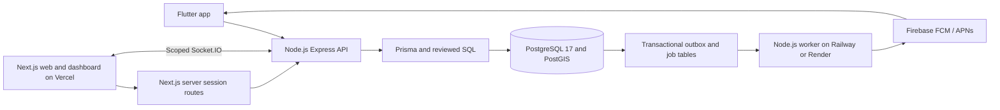

# NSS Blood Donor — Technical Specification

**Status:** Target specification; runnable toolchain scaffolds exist, domain features remain incomplete.
**Updated:** 2026-10-02
**Scope:** Tamil Nadu supervised donor-request coordination pilot and its release gates.

This specification translates the product decisions in [plan.md](plan.md) into
engineering contracts. [featurelist.json](featurelist.json) controls feature
dependencies and acceptance status; [progress.md](progress.md) records actual
implementation and validation. A proposed component below is not a claim that
it exists. The SQL migrations are drafts until applied and permission-tested.

## Review status

| Reviewer | Date | Status |
|---|---|---|
| Product and NSS operations | — | Pending |
| Hospital clinical and privacy owner | — | Pending |
| Backend and security | — | Pending |
| Web and mobile | — | Pending |

## 1. Problem and success criteria

Blood requests and donor responses need a trusted, privacy-safe coordination
channel. A requester must select a verified hospital; assigned hospital or NSS
staff approve requester submissions or directly publish assigned organizational
requests, then coordinate consenting donors. A handler records a
basic check before travel. The hospital alone performs clinical assessment and
decides whether donation can proceed. Verified donation history requires hospital
evidence.

The pilot succeeds when published requests have a reachable owner during stated
staffed hours, users see accurate next steps, unauthorized staff cannot act, and
operators can measure acknowledgement, outcomes, no-shows, notification failures,
accessibility and support quality. Release gates are in [plan.md](plan.md).

## 2. Scope and boundaries

### Included in the pilot

- Android/iOS donor and requester app, responsive public/user website, and
  scoped hospital/NSS dashboard, with Tamil and English core journeys.
- Verified hospital directory; requester submission/review and direct staff-origin
  publication, expiry,
  closure, acknowledgement, ownership and escalation.
- Donor registration/activation, consent, nearby discovery, automatic
  10 → 25 → 50 km → all-coverage alerts, immediate emergency broadcast,
  donor slots/waiting replacements, coordinator calls, private initial-check
  outcome, guarded travel/arrival, hospital-evidenced outcome, verified history
  private compressed acknowledgement-proof uploads and certificate verification.
- Email/password and Google sign-in, staff TOTP MFA, push/inbox, privacy and
  support workflows, audit, monitoring and tested recovery.

### Excluded

- Blood inventory or stock availability, clinical eligibility decisions,
  compatibility advice, detailed hospital screening histories, diagnosis, test values and hospital
  medical records.
- Guaranteed emergency response, blood supply or treatment. The interface must
  show the hospital's direct contact route for immediate help.
- Camp management, component matching and hospital-system integration during
  the pilot. Funded phone OTP/SMS and wider district rollout are later stages.

### Pilot assumptions

Adult-only participation; an invitation-led envelope of about five hospitals,
five NSS units and up to 1,000 registered users, subject to measured capacity.
Each partner supplies staffed hours, a named primary and backup coordinator,
a hospital-approved preliminary-question policy, and acceptable final-outcome evidence.
Exact service thresholds and retention periods require partner approval before
real enrollment.

## 3. Domain design

| Term | Meaning |
|---|---|
| Request | Verified hospital need with REQUESTER/STAFF origin, separate creator/requesting contact/coordinator, quantity, canonical urgency and deadline. |
| Pledge | A consenting donor's response to an open request; at most one active pledge per donor in the pilot. |
| Initial check | A private coordination outcome by assigned staff: `PROCEED_TO_HOSPITAL`, `DO_NOT_PROCEED`, or `HOSPITAL_ADVICE_NEEDED`. |
| Hospital outcome | `DONATED`, `DEFERRED`, or `DID_NOT_DONATE`, backed by hospital reference or named attestation. |
| Verified donation | A `DONATED` outcome with proof, date, quantity, recorder and audit trail; the only source of certificate/history. |
| Assignment | Explicit hospital/NSS membership and partnership scope, checked for every staff action. |
| Alert zone | A hospital-centred server-side radius using consented coarse donor locality; normal stages are 10, 25, 50 km then all configured coverage; emergencies start across coverage. |
| Coordination target | Hospital-approved donor slots for outstanding whole-blood units; confirmed coverage is separate from reserved/waiting donors and verified units. |
| Waiting pledge | Active commitment awaiting a vacant slot; no travel clearance or confirmed coverage. |
| Replacement offer | One time-limited invitation reserving a vacant slot; requires fresh donor acceptance and coordinator check. |

Core bounded contexts are identity and consent, partner organizations and access,
request coordination, donor pledges and outcomes, notifications, and governance.
Private contacts, checks and proof must remain separate from public request
projections. Requester timelines expose coordination milestones only.

### Lifecycle rules

```text
Request: DRAFT → SUBMITTED → OPEN → FULFILLED / CANCELLED / EXPIRED
                 ↘ CHANGES_REQUESTED / REJECTED
Staff:   STAFF DRAFT → authorized direct publication → OPEN
Pledge:  reserved PLEDGED → validated call + check → CONFIRMED → EN_ROUTE → ARRIVED
         WAITLISTED → REPLACEMENT_OFFERED → accepted reserved PLEDGED
                                    ↘ hospital outcome
```

The previous SQL drafts include `DECLINED`, `NO_SHOW`, `DEFERRED`, `DID_NOT_DONATE`
and `DONATED` pledge outcomes. An uncertain check needs documented hospital
direction before travel. Do-not-proceed blocks travel. Request closure and
hospital safety holds stop new pledges and actionable alerts. Only a hospital-
evidenced `DONATED` result creates history and certificates; self-confirmation
is forbidden. Final transition tables, public labels and correction rules must
be reconciled with the API and SQL tests before acceptance.

## 4. Architecture and technology

The owner selected the common stack from
`V:\xerox-booking-app\docs\PROJECT_TECHNICAL_GUIDE.md` on 2026-10-01.
[plan.md](plan.md) records the adopted layers and the blood-donor-specific additions.
The guide's printing/payment features are outside scope; reuse its private
presigned-upload pattern for donation acknowledgement proof. Keep PostGIS,
scoped staff access, staff MFA, hospital evidence and bilingual journeys.



| Layer | Target implementation |
|---|---|
| Mobile | Flutter/Dart, Riverpod state, Dio HTTP, GoRouter navigation, secure token storage and Firebase Messaging. |
| Web | Next.js App Router/React/TypeScript on Vercel; Tailwind CSS/shadcn/ui retained. |
| Web state/network | TanStack Query, Zustand for local UI state, Axios and Recharts reports. Backend credentials stay server-side. |
| Browser session | Next.js server session routes, Secure HTTP-only cookies, CSRF/origin checks, server-held backend tokens and revocation. |
| API | Node.js/Express/TypeScript with router/schema/service modules, Zod, OpenAPI and consistent errors. |
| Identity | Backend-owned users, bcrypt hashes, short-lived JWT access, hashed rotating refresh sessions, verified email and Google/Apple linking, staff TOTP MFA. |
| Data | Prisma Client with PostgreSQL adapter and Prisma migrations; PostgreSQL 17/PostGIS, reviewed SQL workflows, scoped roles/RLS. |
| Jobs | PostgreSQL transactional outbox/job tables; independent Node worker with leases, retries, due-time evaluation and dead-letter visibility. |
| Live events | Socket.IO from Express to authorized staff web sessions; assignment-scoped rooms and REST refetch after reconnect. |
| Localization/contracts | One OpenAPI source with TypeScript/Dart models; i18next on web/backend and Flutter localization/ARB with key/copy parity. |
| Storage | Private R2 for compressed acknowledgement proof, encrypted backups and generated artifacts; no medical records. |
| Hosting | Vercel web, Railway/Render API and worker, managed PostgreSQL (for example Neon), after PostGIS/region/capacity verification; Supabase is excluded. |
| Telemetry/testing | Sentry/redacted logs, Vitest/SQL/pgTAP/Playwright, Flutter unit/widget/integration tests and Maestro device flows. |

### Application structure and request flow

Target folders mirror the guide: `mobile/`, `admin/`, `backend/`, `packages/`,
`docs/`, `scripts/` and CI workflows. The Next.js app in `admin/` contains public,
user and staff route groups; database access is confined to the backend.

```text
Flutter screen/widget -> Riverpod notifier/provider -> repository -> Dio -> Express
Next.js screen -> TanStack Query/Axios -> server session route -> Express
Express router -> authentication/authorization middleware -> Zod schema -> service
Service -> Prisma transaction / reviewed SQL -> PostgreSQL + audit + durable outbox
Node worker -> due job / private inbox -> FCM + scoped Socket.IO update
```

Routes wire endpoints, schemas validate input, and services own business rules.
Ordinary queries use a shared Prisma Client with the PostgreSQL adapter. Use
parameterized reviewed SQL where required for spatial queries, row locks and
workflow/security rules. Migration SQL must retain PostGIS indexes, constraints,
functions and RLS that cannot be fully represented in the ORM schema; Prisma
migrations are the single deployment history. See
[Prisma custom migration guidance](https://www.prisma.io/docs/orm/v7/prisma-migrate/workflows/unsupported-database-features).

Share OpenAPI schemas, language keys/copy and design decisions, with language-
specific models and validation; Flutter does not import TypeScript/Zod or React
components. Dart JSON models must match the OpenAPI responses, including nullable
fields and lightweight list projections. See
[Flutter JSON serialization](https://docs.flutter.dev/data-and-backend/serialization/json).

Business rules live in Express/database. Next.js uses its server runtime rather
than a mandatory static export; browser session routes protect backend credentials.
Mobile tokens use Keychain/Keystore through secure storage and Dio refresh
interceptors. Provider secrets stay in trusted services, never in build-time
Dart defines or browser bundles. Flutter build-time `API_URL` is non-secret.

### Current repository state and migration boundary

Workspace configuration, `supabase/config.toml` and two unapplied SQL migrations
are drafts from the previous stack, not an Express/Prisma implementation. The
runner, seed, API, clients, worker, CI and runtime tests are missing. `legacy/`
remains reference material; its Flutter code is not a verified active client.
See [progress.md](progress.md) for evidence and the Docker blocker.

`F002` must replace the old toolchain/commands with Compose PostgreSQL/PostGIS,
Express/Next.js Node workspaces and Flutter SDK/pub setup. `F003` ports the draft
SQL into `backend/prisma/migrations/`, replacing Supabase-specific identity,
roles, grants and queue dependencies. Use backend-owned identity and transaction-
local trusted actor/MFA context; clients cannot choose that context or call SQL
workflows directly. Review every prior `auth.uid()`/JWT/MFA assumption. Only one
migration runner and one identity system may be active. Apply and permission-test
the port before accepting it; preserve the old drafts as references until then.

## 5. Data and authorization contracts

The previous Supabase migration drafts describe `app` tables for profiles, preferences, consent,
organizations, memberships, partnerships, requests and private request fields,
pledges, initial-check events, hospital-outcome events, donations, certificates,
devices, notifications, delivery attempts, audit events, idempotency, reports,
privacy requests, rate limits and failed jobs. UUIDs and UTC timestamps are used;
indexes, foreign keys, bounded enums, versions and uniqueness constraints guard
critical transitions. Port these domain rules into Prisma migrations, adding
backend identity/session tables and transactional outbox/job tables. PostGIS
supports nearby queries; no clients receive direct database credentials.

| Actor | Allowed scope |
|---|---|
| Visitor | Public information and verified hospitals. |
| Donor/requester | Own profile, requests, pledges, notifications and verified history. |
| NSS controller | Assigned partner hospitals, coordination and basic checks; hospital-evidenced outcomes. |
| Hospital staff | Own hospital scope and the same coordination actions; hospital clinicians retain clinical decisions. |
| Platform administrator | Organization verification, memberships, abuse and platform operations. |

Every privileged operation must recheck active membership, explicit assignment,
account state and staff MFA at both API and database boundaries. Either authorized
hospital staff or NSS coordinator may publish assigned requests without a mandatory
second publisher, including requests they created. Own donation verification is
forbidden. Request origin records provenance, not an extra approval gate. Direct client writes that bypass
workflow functions are forbidden. Consent withdrawal immediately stops future
matching, contact or push for that purpose. Export/deletion and retention rules
need accountable owners and tested execution.

Store the private versioned preliminary checkbox questionnaire responses, sharing
consent and submission time, plus initial-check outcome/reviewer/time/version and
hospital direction when needed. Store donation proof/facts for the final outcome.
No weights, diagnoses, detailed histories, test values or hospital medical records.
Questionnaire responses and contacts are visible only to the donor and assigned
staff through protected endpoints; notifications/public/requester projections omit
responses, patient names, private references, contacts and check results.

### Donor registration contract (`F006`, `F016`)

Verified email/password signup or supported provider sign-in creates/resumes one
profile per backend user. Onboarding records adult participation confirmation,
name, self-reported blood group, language, coarse locality and confirmation time,
private E.164 contactNumber, contactVersion, availability and versioned purpose-
specific alert/contact-sharing consent.
Foreground location is optional; manual locality must work when denied. No
health answers, test results or movement history are collected.

`/v1/me` returns completion/activation status and missing required fields. Server
validation excludes incomplete/unverified accounts and absent/invalid numbers
from matching and pledging;
matching also excludes paused availability, stale locality/preferences and absent
required consent. Staff privileges require separate verified memberships. Push
permission is separate from alert consent: denial leaves onboarding and inbox
usable. Profile/consent completion is transactional and idempotent; repeat
submissions cannot duplicate consent events. Web/mobile support resume, editing,
pause/withdrawal and Tamil/English validation. Registration is not clinical clearance.

Phone format/country normalization, shared-number allowance, self-reported status,
per-version coordinator call validation and changed-number handling follow plan.md's
contact contract. Phone is not a login identifier and no OTP is required in v1.
Successful call validation plus a proceed outcome and live reservation gate
CONFIRMED; E.164 format validation alone cannot do so.

### Request/publication and consent contracts (`F011`, `F012`, `F016`, `F030`)

Use plan.md's transition table as the authoritative contract; mirror it in OpenAPI,
SQL guards and tests. Server assigns REQUESTER origin to ordinary creation and
STAFF origin only through scoped POST /v1/requests/staff; require a private E.164
requesting contact or registered requester reference. POST /v1/requests/:id/publish
checks assignment/MFA and publication gates for either authorized role. Reject forged origin/actor fields. Creator, requesting contact and
coordinator remain distinct. Either authorized hospital staff or NSS coordinator may publish any assigned
ready request, including their own creation; no mandatory second reviewer. Origin
is provenance only and cannot grant publication privileges to an ordinary user.
Hospital group changes need replacement requests; only evidenced corrections may
reopen FULFILLED with fresh policy/deadline. No generic terminal-state reopening.

Canonical urgency is NORMAL | URGENT | CRITICAL | EMERGENCY, identically in SQL,
Zod/OpenAPI, generated TypeScript/Dart and locale keys. First two use gradual
search; last two immediately use all coverage. Old LOW/MEDIUM/HIGH SQL is reference
only. Optional future import mapping is LOW->NORMAL, MEDIUM->URGENT, HIGH->CRITICAL;
never infer EMERGENCY. Urgency does not establish a clinical diagnosis.

Hold is a hospital flag independent of request status. Hospital staff alone may
set/release it with reason. Preserve commitments/attendance and pause pending
contact/offer/evaluation timers; effective request expiry (min(deadline, expiry))
still runs. Release revalidates consent/availability and schedules fresh bounded
work. Closure resolves coordination; hospital evidence from existing visits can
still reconcile with audit, without issuing new travel instructions.

Contact-sharing withdrawal removes contact access immediately and atomically ends
pre-donation commitments, releases slots and schedules staff/replacement work.
Preserve attendance/history for evidence reconciliation without renewed contact.
Alert-consent withdrawal suppresses matching/push and cancels WAITLISTED or
REPLACEMENT_OFFERED; accepted commitments may continue with contact consent and
inbox only. OS push denial/availability pause alone does not cancel commitments.
Manual handoff cannot delay withdrawal and queued work always rechecks consent.


### Matching, slots and waiting replacements (`F017`–`F023`)

The authoritative behavior is the agreed workflow in [plan.md](plan.md). Extend
Prisma migrations with immutable partner/coverage policies, request search state,
slot reservations, contact deadlines, ordered waiting pledges, expiring replacement
offers, hospital-approved checklist versions and private proof metadata. Previous
SQL drafts do not implement these additions.

1. Normal publication queues 10 km matching, then >10–25 km, >25–50 km and
   previously uncontacted donors across enabled Tamil Nadu coverage. Critical/
   emergency publication or upgrade queues all coverage immediately. All stages
   require activated registration, group, availability, consent, freshness and
   contact limits; emergency status cannot override them. Use PostGIS metres.
2. Empty stages advance immediately; other stages use approved urgency windows.
   Compare outstanding donor-slot targets with confirmed coverage. Full pending
   reservations/offers temporarily pause invitations until their approved deadline;
   waiting/uncertain donors are never counted as confirmed. Waiting replacements
   precede renewed wider invitations. Exhaustion invokes coordinator/backup handoff.
3. Acceptance transaction locks request capacity and donor active commitment,
   reserves a slot or returns WAITLISTED, records audit and enqueues inbox work.
   One active pledge includes waiting/offered states. Original rejection prevents
   repeat invitations; voluntary reopening may accept while the request is open.
4. Waiting order is acceptance time then pledge ID. Vacancies reserve one slot
   per REPLACEMENT_OFFERED pledge. Donor freshly accepts before offer expiry;
   contact/check completion is still required before CONFIRMED or travel. Decline,
   expiry, no-show, cancellation, failed contact or non-donation releases capacity
   and reevaluates the queue. Serialize promotions and expiry with row locks,
   expected versions and idempotency; scheduling/state/audit/outbox commit together.
5. Snapshot coverage, response/contact/offer windows, freshness/contact/renewal
   limits and slot policy at publication;
   reject missing/unapproved policy. Policy integer bounds and expiry caps are
   defined in plan.md; synthetic values cannot become production defaults. Upgrades are audited policy transitions.
   Holds suspend pending coordination timers while deadline/closure stops new
   actions; authorized release/evidenced FULFILLED reopening requires reconciliation
   and fresh scheduling. Never replay expired travel instructions.
6. Requested units, slot target, pending/confirmed/waiting donors, hospital-verified
   units and pending proof are distinct projections. V1 slots equal max(0, requested units - verified units); surplus acceptances
   remain waiting rather than adding travel slots. Confirmation pauses search; the assigned admin sends the donors-ready notice
   through POST /v1/requests/:id/notify-ready so the requesting person can pause
   additional search. Only hospital-verified units fulfill the request; final staff
   validation atomically closes when the required units are met.
   Verified donation ends its commitment and reduces outstanding units/slots in
   the same transaction before capacity release can promote a replacement.
   Quantity reduction releases surplus non-travelling slots in reverse reservation
   order; travelling/arrived donors require staff reconciliation. Outside-app
   fulfillment stops unnecessary travel. Corrected outcomes can create a shortfall;
   reopening a closed request requires an audited staff decision.

Discovery retains its independent 25 km default and 10/25/50 km choices. No
background movement tracking or client-driven stage advancement. Recheck state,
consent and availability at evaluation, promotion and send time. Original invitations
are unique per donor/request; replacement offers use distinct per-offer event keys.
Processing latency targets exclude intentional partner-approved waiting windows.

### Checkbox questionnaire and admin validation call (`F019`)

After Accept, show the five default plan questions with exclusive Yes/No/Unsure
checkbox responses, no defaults and explicit sharing consent. Authorized assigned
hospital/NSS admins create/edit/activate immutable Tamil/English question versions
under hospital-approved policy. Each request pins a version at publication; new
admin edits apply to future requests, never rewrite submitted responses.

Submitting questionnaire version/question IDs/bounded responses/consent atomically
creates the reserved or waiting pledge; unanswered/unconsented forms cannot enter
the validation queue. Store private responses encrypted/protected with donor,
pledge, version and time. Requester/public lists never embed them. Assigned admins
see consenting donor details and responses before calling; waiting donors see their
status and do not travel. Fresh replacement acceptance reconfirms responses before
validation. No diagnoses, measurements or free-text clinical histories are accepted.

The user selected an admin Call button that opens the phone dialler. Show a scoped
callable donor number; tel-link opens the dialler, and an unavailable handler gives
a clear fallback to use the number on the coordinator's phone. Call attempts/results
and proceed/advice-needed/do-not-proceed decisions are recorded by assigned staff.
Successful contact-version call validation plus proceed and reserved capacity gate
CONFIRMED. Checkbox values alone never make an eligibility decision; hospital
clinical assessment follows arrival. No call recordings are collected.

Responses may be read only by the donor/assigned staff (MFA for privileged access).
Reject cross-donor/unassigned reads and forged versions/question IDs; never send
answers in push/broad socket events, analytics, logs or crash reports. Audit access;
withdrawal removes sharing access immediately. Approve response retention/deletion
and hospital policy before real enrollment; personal export includes only that
donor's authorized record. Tests prove private submission/retry/read/redaction.

### Compressed hospital certificate upload (`F021`, `F022`)

Donors upload their hospital donation certificate/acknowledgement after donating.
Use private R2 direct upload: authorized presign → upload → completion verification
→ hospital/NSS review. One JPEG/PNG/PDF proof per pledge by default, maximum 2 MiB
post-compression, five-minute presign. Donor previews legibility; server verifies
actual size/type/content, strips image metadata and quarantines suspicious files.
Store upload status/key/checksum/owner/pledge metadata in PostgreSQL; object keys
are server-generated and finalized idempotently. Flag reused proof for review;
never expose public object URLs or signed URLs in logs. Authenticated scoped
reads or short-lived downloads enforce donor/assignment access at request time.

Cleanup unfinalized uploads after 24 hours; finalized evidence follows approved
field/object retention and tested private backup/restore. Hospital references or
named attestations remain valid alternatives. Evidence pending is separate from
verified donation; missing upload alone cannot trigger replacement. Upload never
creates a donation/history/certificate until staff verify the hospital outcome.
Reject medical reports and preserve audited disputes, corrections and revocation.
Operational failure reasons are bounded neutral codes, never diagnosis or free-
text health reasons; replacements receive no prior-donor reason. Verified donation
dates support hospital-approved contact pauses; recent outside-app donation is
discussed privately and donors may pause alerts, without app eligibility claims.

## 6. API and event contracts

The planned versioned REST surface is `/v1/me`, `/v1/hospitals`, `/v1/requests`,
`POST /v1/requests/staff`, `POST /v1/requests/:id/publish`,
`POST /v1/requests/:id/notify-ready`,
`/v1/pledges`, `/v1/hospital-outcomes`, `/v1/donations`, `/v1/devices`,
`/v1/notifications`, `/v1/organizations`, `/v1/memberships`, `/v1/reports`,
`/v1/pledges/:id/evidence/presign`, `/v1/pledges/:id/evidence/complete`,
plus `/health/live` and `/health/ready`. OpenAPI and generated client types
must reflect the implementation. The draft SQL exposes `public` workflow
functions such as `create_request`, `request_action`, `create_pledge`,
`record_initial_check`, `pledge_action`, `record_hospital_outcome`,
`list_donations` and certificate verification; these are not yet a tested API. Port or replace
them with reviewed SQL/Prisma transactions that preserve all actor, MFA,
assignment, evidence, concurrency and audit checks without Supabase identity.

- Validate IDs, coordinates, quantities, lengths, enums and unexpected fields.
  Accept only approved questionnaire version/IDs/bounded responses at its private
  endpoint; reject extra diagnosis/test/medical-history fields everywhere.
- Use cursor pagination, default 20 and maximum 100. Require idempotency keys
  for pledges, publication and final donation recording.
- Require expected versions for mutable workflow transitions; return `409` for
  stale or invalid concurrent transitions.
- Return consistent errors with code, safe message, optional fields and
  correlation ID. Never expose SQL internals, stack traces or secrets.
- Commit workflow mutation, audit event and notification enqueue atomically.
  External push failure must not roll back a committed business result.

| Command/event | Required side effect |
|---|---|
| Request published | Audit publication; initialize normal Zone 1 or immediate all-coverage emergency matching, bounded by expiry. |
| Alert zone advanced or exhausted | Atomically persist versioned search state, audit and next evaluation/new invitations or coordinator handoff; requester-safe milestone only. |
| Pledge created or changed | Reserve/release capacity or waitlist atomically; audit and update scoped views/inbox. |
| Replacement offered/expired | Reserve at most one vacant slot, require fresh response, schedule deadline and reevaluate after expiry. |
| Confirmed target reached/lost | Pause/resume coordination; admin sends ready notice when guarded coverage is sufficient; subsequent loss emits neutral shortfall update. |
| Proof uploaded/reviewed | Verify/quarantine private object, notify scoped reviewer; no automatic donation confirmation. |
| Initial check recorded | Audit privately; authorize or block travel; no requester disclosure. |
| Hospital outcome recorded | Assigned hospital/NSS admin verifies proof; DONATED updates units/history and atomically fulfills at target, queues closure notifications and dashboard update. |
| Request closed or held | Stop new actions; closure resolves commitments, hold suspends them with staff travel reconciliation. |

The existing `/v1/me` contract includes donor registration completion/activation;
`/v1/requests` exposes zone/search status to assigned staff and only neutral
expansion/exhaustion milestones to requesters. Staff policy and approved checklist-version management stays
within scoped `/v1/organizations` administration. `/v1/pledges` exposes waiting
status, replacement offers/reconfirmation, contact attempts and private versioned
questionnaire submission; the initial-check decision pins its approved checklist version. Clients cannot arbitrarily
advance zones, change policy snapshots or enumerate donors. Scheduled evaluators
use trusted workflow functions and the same assignment/privacy boundaries.

## 7. Notifications and integrations

Register FCM tokens after authentication, support multiple devices and rotation,
and unregister on logout. Persist an inbox item before attempting push. The
worker reads bounded durable batches, retries with backoff, deduplicates by
event/recipient/device, removes invalid tokens, and rechecks request state and
consent at send time. Track queued, provider-accepted, failed and opened
separately. Lock-screen content must be neutral. An uncertain, unvalidated, waiting or declined donor
must not receive travel instructions; a deferred donor receives private advice
to contact the hospital without a medical reason.

Zone evaluation jobs are durable and idempotent. Deduplicate actionable
invitations by donor/request across zones, then delivery by invitation/device.
Provider acceptance or lack of a push token is not proof of a donor response.
Foreground accept/reject dialogs and background notification-tap navigation fetch
current server state. No forced-popup guarantee. Expired offers cannot accept;
replacement notices, waiting notices and closure updates use distinct event keys.
Expose scoped current zone, response counts, next evaluation and exhausted state
on the staff dashboard; requester timelines omit identities and donor locations.

Express owns authentication and authorization. Passwords use bcrypt (guide
baseline cost 12, measured and pinned during implementation). Email verification
and reset tokens expire, are single-use and are hashed at rest. Use short-lived
JWT access tokens and hashed rotating refresh sessions with reuse detection,
logout/account-disable revocation and sensitive-action reauthentication. Google
and Apple identities must be server-verified and linked only with authenticated
ownership proof. Staff TOTP MFA gates privileged API and database actions; never
trust client-provided roles or MFA flags. Funded phone OTP/SMS remains later scope.
Custom SMTP needs a verified sender. Development and production Firebase
projects and secrets must be separate. Backups target encrypted private storage;
restore must cover business data, backend identity/session data, Prisma migration
history, schema and access rules. Invalidate pre-restore sessions during recovery
so an older refresh-token backup cannot revive revoked access.

### Socket.IO staff updates

Emit safe change notices after committed mutations/outbox processing, never
patient details or private check results in broad rooms. Socket handshakes use
short-lived server-issued connection tickets derived from the HTTP-only web
session, not browser-stored access/refresh tokens. Allowlisted origins,
rate limits and room membership require active session, MFA and explicit hospital/
NSS assignment. Recheck access on subscriptions and before protected emissions;
revocation disconnects affected sockets. Reconnect reauthorizes and refetches
REST data; missed or duplicate events cannot create or confirm a transition.
A Socket.IO outage leaves REST queues and the notification inbox usable.

## 8. Nonfunctional requirements

| Area | Acceptance target |
|---|---|
| Accessibility | WCAG 2.2 AA web target, equivalent native access; keyboard, TalkBack, VoiceOver, 200% text and 320-pixel layouts. |
| Language | Tamil and English for every core journey, alert and support path. |
| Web performance | p75 LCP ≤2.5 s, INP ≤200 ms, CLS ≤0.1. |
| API | p95 reads ≤750 ms; writes ≤1 s, excluding provider delivery, at agreed pilot load. |
| Mobile | Usable initial screen ≤3 s on selected mid-range device; ≥99.5% crash-free pilot sessions. |
| Notification processing | p95 publication to provider acceptance ≤60 s normally; failures remain visible. |
| Recovery | Initial RPO ≤24 hours and RTO ≤8 hours, verified by restoration. |
| Security | OWASP ASVS Level 2 baseline; scoped direct-access tests, MFA, CSRF, rate limits, audit and secret scans. |

Offline screens must label stale data and never claim mutation success before
server confirmation. Availability and capacity figures require measurement;
free provider allowances do not establish an SLA.

### Implementation prerequisites and ownership

F002 is the only initial unfinished ready feature: reconcile old Supabase/Hono/
apps/* config; pin pnpm 10.32.1, Node 24 and Flutter SDK; implement Compose and real
command wrappers; capture a reviewed feature-only baseline and prove a clean
checkout. F003 supplies identity/session/org foundation; F004 supplies donor and
request workflow tables/constraints and canonical enum/transition contracts.
F011/F012/F016/F017/F018/F023 require F004 directly or transitively. F006 accepts
backend auth independently; F008 owns browser sessions and F009 owns client token
transport against generated contracts, preventing a circular completion gate.

Existing draft commands/migrations are not executable acceptance evidence. An
unavailable Docker engine or registry is recorded as an F002 blocker and cannot
be bypassed by marking downstream work done. Baseline staging must use explicit
paths and exclude unrelated legacy deletions; verify references in a clean
checkout, including any deliberately retained previous-stack reference files.

## 9. Development and testing

Use pinned pnpm/Node for Express/Next.js and Flutter/Dart SDK/pub for mobile,
with Docker Compose PostgreSQL 17/PostGIS. Prisma migrations and synthetic seeds
must rebuild an empty isolated database; validate/generate Prisma Client and
TypeScript/Dart API contracts in CI. Run `flutter analyze`, unit/widget tests,
Flutter integration tests and Maestro against installed builds as appropriate.
`package.json` lists intended commands; several target files or packages do
not exist yet, so a script name is not validation. [Docker recovery notes](DOCKER-RECOVERY.md)
record the host issue. Synthetic seeds only; no production credentials or
patient data in fixtures.

Required tests span SQL constraints and direct-access grants/RLS; API ownership,
MFA, idempotency, concurrency and lifecycle; web sessions/CSRF; Tamil/English
donor/requester/staff journeys; Playwright accessibility and responsive checks;
real Android/iOS FCM behavior; worker crash/retry and stale-alert handling;
JWT rotation/replay and revocation, verified provider identity linking, scoped
Socket.IO handshake/rooms/reconnect/revocation, load, security and backup
restoration. In particular, test that a declined or
deferred donor never gains a certificate, revoked memberships lose access
immediately, and requester/public projections leak no private check result.

Registration tests cover resume/idempotency, verification and activation gates,
manual locality with location denied, push denial with inbox access, consent
withdrawal and Tamil/English errors. Matching tests cover exact 10/25/50 km
boundaries, no contactable donors, timed shortfalls, target pause/resume, exhausted
handoff, contact limits and locality freshness. Exercise concurrent evaluators,
worker restart, donor locality changes and deduplication across zones/devices;
closure/expiry/holds or revoked consent must suppress queued invitations. Verify
that discovery filters do not alter zones and scoped status leaks no donor data.

Additional acceptance cases: publication by either staff/coordinator without a second publisher;
invalid/shared/missing phone and contact-version changes; canonical urgency values;
hold timer suspension/release/expiry; both consent-withdrawal paths;
concurrent two-slot acceptance and double promotion;
contact/offer timeout and worker restart; withdrawn consent before promotion;
emergency upgrade and all-coverage deduplication; rejection suppression; edited
quantity/deadline and external fulfillment; failed hospital visit and neutral
replacement notices; delayed proof with real donation pending reconciliation;
private unreadable/oversized/spoofed/malicious upload and orphan cleanup; denied
cross-donor downloads; questionnaire version immutability and private answers in authorized API/storage
only, absent from public/requester views, telemetry and notifications. Reconcile confirmed-target notices, partial
verified units, outcome corrections and every active pledge on closure/hold.

## 10. Rollout, operations and milestones

Stages in [plan.md](plan.md): partner setup, foundation/database, requests,
checking/outcomes/notifications, quality/recovery, controlled pilot, then
funded expansion. Feature dependencies and individual acceptance evidence live
in [featurelist.json](featurelist.json) and [progress.md](progress.md). Pilot
enrollment waits for named partner owners, staffed hours, agreed scorecard,
clinical/privacy signoff and all release gates.

Deploy reviewed Prisma migrations before the matching Express/worker release;
deploy Next.js on Vercel and signed Flutter Android/iOS builds through store
testing. Provision HTTPS, database/PostGIS, SMTP, Firebase/APNs and private R2,
validate secrets and explicit HTTP/socket origins, and rehearse rollback.
Deploy backward-compatible migrations and retain a previous release for
rollback. Monitor API errors, publication and acknowledgement delays, stale
urgent requests, queue age, failed jobs, notification acceptance, quotas,
backup success and restoration checks. Use redacted logs with correlation IDs.
Pause enrollment if a core journey or privacy boundary fails, an urgent request
has no reachable owner, or signed thresholds are exceeded. Resume after owner
resolution and retest. Keep a direct hospital phone workflow during outages.

## 11. Partner approvals and deployment gates

- Hospital-approved checklist versions, evidence formats and clinical/partner
  signoff for uncertain cases.
- Pilot scorecard thresholds for acknowledgement, escalation, support and queues.
- Partner-approved response/contact/offer windows, slot targets and service
  coverage for normal 10 → 25 → 50 km → all-coverage and immediate emergencies.
- Field-level retention durations, lawful holds, deletion method and backup expiry.
- Implement/test the resolved plan.md transition table and canonical contracts;
  no publication/hold/withdrawal/urgency semantics remain delegated to implementers.
- Managed PostgreSQL provider/region/PostGIS support, API/worker hosting, quotas,
  credentials, measured capacity and release/store approvals.
- F002 pins the selected SDK/dependency versions and records reproducible checks;
  F003 ports references and F004 enforces the resolved workflow/data contracts.
  Auth uses the documented backend JWT/rotating-session design and trusted SQL actor
  context; provider credentials and real deployment signoff remain launch gates.

## 12. References

- [Project plan](plan.md)
- [Feature tracker](featurelist.json)
- [Progress and validation log](progress.md)
- [Docker recovery](DOCKER-RECOVERY.md)
- [Previous-stack draft foundation migration](../supabase/migrations/202609290001_foundation.sql)
- [Previous-stack draft workflow migration](../supabase/migrations/202609290002_workflows.sql)
